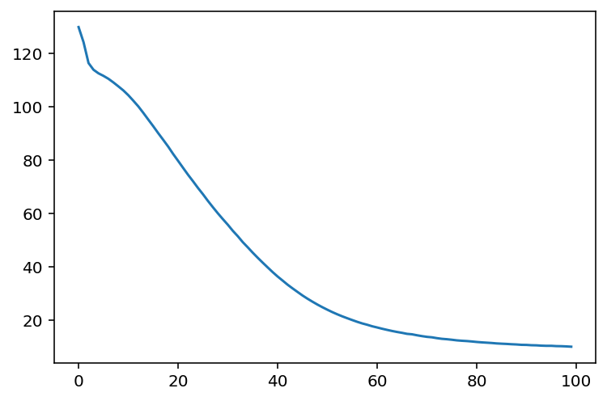
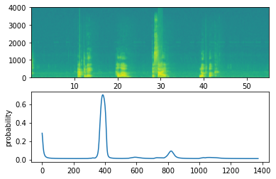
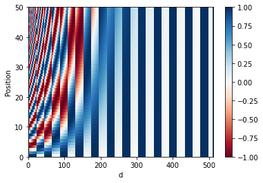

# Sequence Learning for Text, Music, and Audio

I implemented recurrent networks and attention components for sentence classification, music generation, date normalization, and trigger word detection. The projects connect RNN/LSTM internals with practical preprocessing, sequence generation, and evaluation workflows.

## My implementation

- Implemented RNN/LSTM operations, word-vector similarity, and sentence classification within the supplied notebooks.
- Built LSTM music generation, an attention-based date-normalization model, and an audio trigger-detection workflow.
- Implemented positional encoding, attention, and Transformer encoder-decoder components in TensorFlow.

## Recorded comparison: text-to-emoji classification

| Model | Test accuracy |
| --- | ---: |
| Averaged word embeddings with a softmax classifier | 91.07% |
| LSTM sentence classifier | 83.93% |

In the saved runs, the simpler embedding baseline outperforms the LSTM on the provided test set. This comparison highlights the need to evaluate added model complexity against a baseline. These are saved notebook results, not newly rerun benchmarks or evidence of performance on broader text data.

## Model snapshots

### LSTM music generation

The loss curve comes from the saved training run for the jazz generation model.

### Trigger word detection

The saved audio example shows the input spectrogram and predicted activation probabilities over time.

### Transformer positional encoding

The encoding visualization shows how position information varies across the embedding dimensions.

## Projects

| Project | Implementation |
| --- | --- |
| [RNN and LSTM building blocks](W1_ANSWERED/W1A1/Building_a_Recurrent_Neural_Network_Step_by_Step.ipynb) | Forward propagation and backpropagation through recurrent cells. |
| [Jazz generation](W1_ANSWERED/W1A3/Improvise_a_Jazz_Solo_with_an_LSTM_Network_v4.ipynb) | Training an LSTM sequence model and sampling musical outputs. |
| [Word-vector similarity and analogies](W2_ANSWERED/W2A1/Operations_on_word_vectors_v2a.ipynb) | Cosine similarity and analogy completion with pretrained embeddings. |
| [Text-to-emoji classification](W2_ANSWERED/W2A2/Emoji_v3a.ipynb) | Sentence classification with embedding-based and LSTM models. |
| [Date translation with attention](W3_ANSWERED/W3A1/Neural_machine_translation_with_attention_v4a.ipynb) | An attention-based encoder-decoder for normalizing human-readable dates. |
| [Trigger word detection](W3_ANSWERED/W3A2/Trigger_word_detection_v2a.ipynb) | Audio preprocessing, synthetic training examples, and sequence predictions. |
| [Transformer implementation](W4_ANSWERED/W4A1/C5_W4_A1_Transformer_Subclass_v1.ipynb) | Positional encoding, attention, and encoder-decoder layers in TensorFlow. |

## Run locally

The notebooks use Python, NumPy, TensorFlow/Keras, Matplotlib, pandas, h5py, and audio-processing utilities. Open Jupyter from the selected notebook directory. Restore the embeddings, datasets, pretrained weights, or audio files referenced by that notebook before running its cells in order. Some notebooks require versions compatible with their original TensorFlow/Keras APIs.

Figures and metrics on this page are taken from saved notebook outputs. A fresh environment and full execution have not been verified for this documentation update.

The word-vector similarity and analogy components are implemented. The optional debiasing section remains unfinished.

## Acknowledgements

Developed from exercises in Andrew Ng's Deep Learning Specialization by DeepLearning.AI. The original problem statements, starter code, supplied utilities, diagrams, datasets, and pretrained models belong to their respective authors. Existing third-party attribution and licenses are retained.
